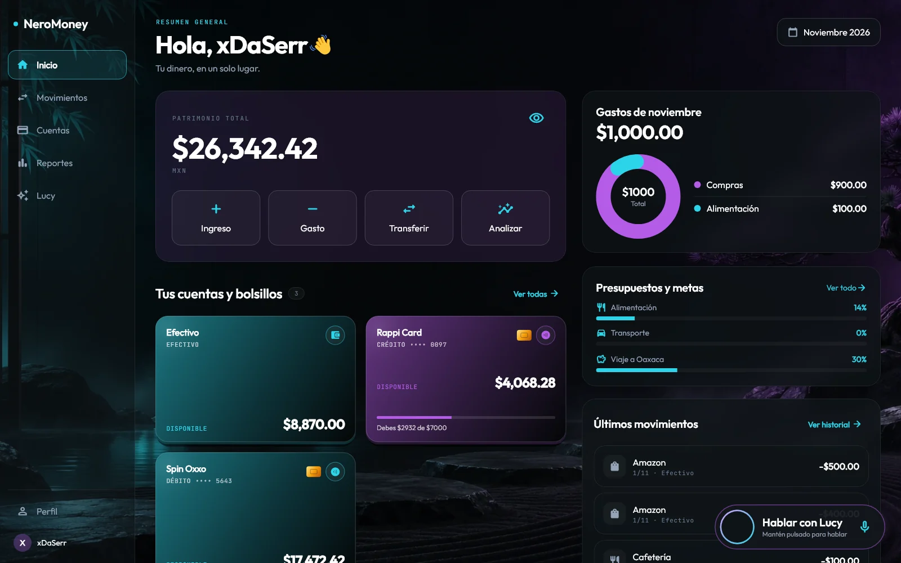
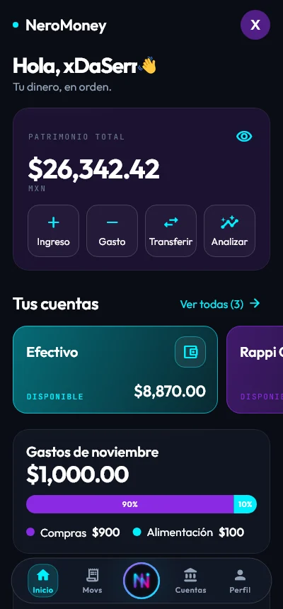
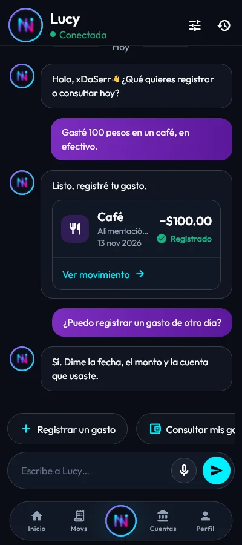
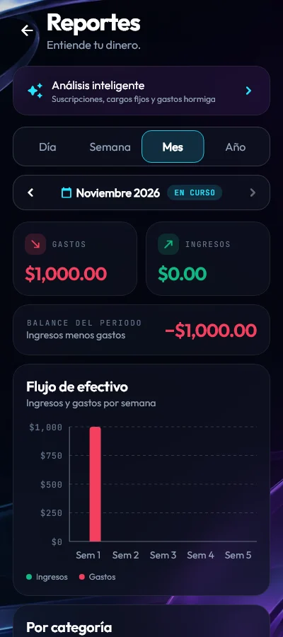
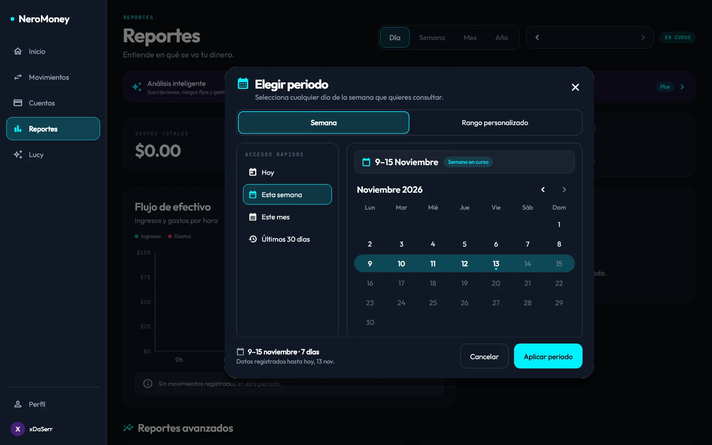
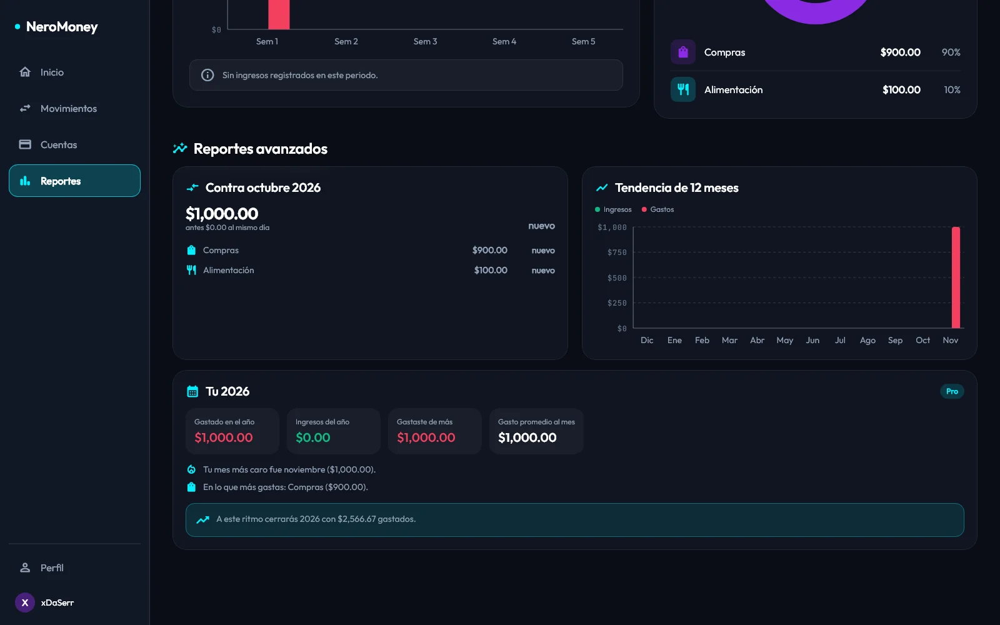
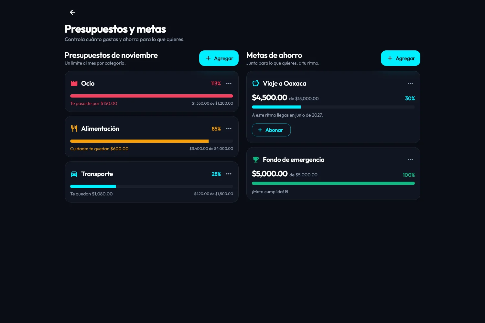
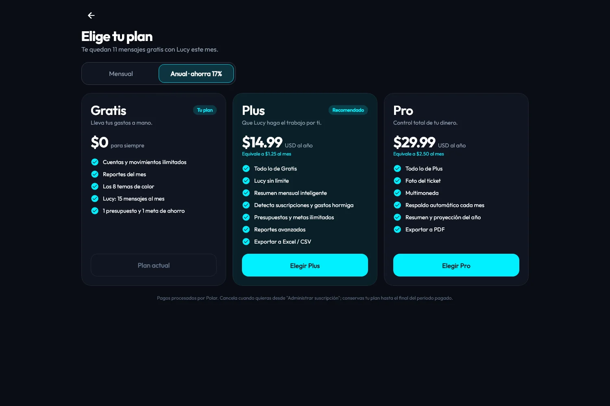

<div align="center">

# NeroMoney

**Finanzas personales con una asistente de IA a la que le hablas como a una persona.**

Dile a Lucy *"gasté 200 en un café con la tarjeta"* y ella lo registra, actualiza el saldo y te avisa cómo vas.

[**Abrir la app web →**](https://neromoneyapp.web.app)


-22E6FF)



</div>

## Qué hace

- **Lucy, la asistente.** Registra gastos, ingresos, transferencias y pagos de tarjeta escribiéndole o hablándole, también los de otros días (*"el 20 de noviembre pagué la luz"*). Crea presupuestos y metas, abona a tus metas y te dice cómo vas. Si le falta un dato (la cuenta) te lo pregunta sin trabar el chat. El nombre y la voz son configurables.
- **Cuentas y tarjetas.** Efectivo, débito, crédito y vales, con los últimos 4 dígitos para distinguirlas, límite de crédito y lo que debes en cada una.
- **Movimientos.** Historial en tiempo real, búsqueda y filtros. Cada movimiento ajusta el saldo de su cuenta en la misma operación, así nunca se desajustan.
- **Reportes.** Por día, semana, mes, año o un rango libre, con calendario propio, flujo de efectivo y gastos por categoría.
- **Presupuestos y metas de ahorro**, con una barra de avance que cambia de color cuando te acercas al límite o lo pasas.
- **Libreta.** Lo que prestas y lo que te prestan: la persona y su celular, de qué cuenta salió el dinero, cuándo quedó de pagar y los pagos en partes. Avisa cuando un préstamo ya pasó su fecha y abre WhatsApp con el mensaje listo.
- **Compartido (Pro).** Una pareja o familia lleva sus gastos en común: quién pagó, entre quiénes se divide, quién le debe a quién y metas de ahorro juntos. Se invita con un código.
- **Recordatorios** para registrar tus gastos, también en la versión web (notificaciones push).
- **Análisis inteligente.** Detecta suscripciones, cargos fijos y gastos hormiga, y genera un resumen del mes.
- **Foto del ticket.** Le tomas foto al ticket y la IA llena el movimiento.
- **Multimoneda**, con tipos de cambio diarios y todo convertido a tu moneda principal.
- **Exportar** a Excel/CSV y PDF, y **respaldo automático** cada mes.
- **Apariencia.** 8 temas de color y 5 fondos ilustrados; la paleta de la app se adapta a cada fondo.
- **Diseño adaptable.** En escritorio la app tiene menú lateral y paneles; en teléfono, una barra inferior y vistas a pantalla completa. Se instala como app desde el navegador, en computadora o en el teléfono.

<p align="center">
  
  
  
</p>

<p align="center">
  
  
</p>

<p align="center">
  
  
</p>

## Planes

| | Gratis | Plus | Pro |
|---|---|---|---|
| Precio | $0 | $1.50/mes · $14.99/año | $2.99/mes · $29.99/año |
| Cuentas, movimientos y reportes del mes | ✓ | ✓ | ✓ |
| Mensajes con Lucy | 15 al mes | 100 al día | 300 al día |
| Presupuestos y metas | 1 y 1 | Ilimitados | Ilimitados |
| Temas de color | 8 | 8 + 5 fondos | 8 + 5 fondos |
| Resumen mensual, suscripciones y gastos hormiga | | ✓ | ✓ |
| Reportes avanzados y exportar a Excel/CSV | | ✓ | ✓ |
| Foto del ticket, multimoneda, PDF, respaldo mensual, resumen del año | | | ✓ |
| Gastos y metas compartidos en pareja o familia | | | ✓ |

Los pagos se procesan con [Polar](https://polar.sh), que funciona como *merchant of record* y se encarga de los impuestos de cada país.

## Cómo está hecho

```
Flutter (web instalable)
   │  Firebase Auth: correo/contraseña y Google
   │  Cloud Firestore: datos de cada usuario, en tiempo real
   ▼
Cloud Functions (Node 22)
   ├─ interpretarMensajeIA   → DeepSeek (function calling) para Lucy
   ├─ resumenMensualIA       → resumen del mes, uno al día, con caché
   ├─ leerTicketIA           → lectura de tickets con visión
   ├─ tiposDeCambio          → tipos de cambio diarios, con caché
   ├─ respaldoMensual / respaldoAhora
   ├─ recordatoriosWeb       → push cada 15 min según la zona horaria de cada quien
   ├─ crearGrupo · unirseAGrupo · salirDeGrupo   → gastos compartidos
   └─ crearCheckoutPolar · abrirPortalPolar · webhookPolar
```

- **Frontend:** Flutter con Material 3, Riverpod 3 para el estado y go_router (`StatefulShellRoute`) para la navegación, con redirecciones según la sesión y el onboarding.
- **Organización por funciones:** `lib/features/<función>/` con `data/` (modelos y repositorio de Firestore), `providers/` y `widgets/`. Lo compartido vive en `lib/core/` (tema, router, widgets base, moneda).
- **Diseño:** sistema propio *Obsidian Cyber-Glass*: superficies de vidrio oscuro, acentos turquesa y amatista, tipografías Outfit y JetBrains Mono, y transiciones donde el botón se estira hasta convertirse en el panel.
- **Pruebas:** pruebas de widgets y de lógica en Flutter (incluyendo capturas en escritorio y teléfono con cada tema) y pruebas de las Cloud Functions con Node.

## Seguridad

- **Ningún secreto vive en el código.** Las llaves de DeepSeek y de Polar están en Google Secret Manager y solo las leen las Cloud Functions en el servidor.
- **Las claves de Firebase que ves en el repositorio son públicas por diseño:** identifican el proyecto, no dan acceso a los datos. Lo que protege la información son las reglas de Firestore (`firestore.rules`): cada usuario solo puede leer y escribir su propio espacio.
- **Lo que se paga se valida en el servidor.** El plan de cada usuario y su consumo de IA solo los escribe el backend. El límite de mensajes se cuenta en la función antes de llamar a la IA, y el webhook de pagos verifica la firma de cada evento.

## Licencia

© 2026 Daniel Serrano. Todos los derechos reservados.

El código está publicado para que se pueda ver como portafolio, pero no se puede copiar, modificar, redistribuir ni usar para publicar otra app. Consulta [LICENSE](LICENSE).
